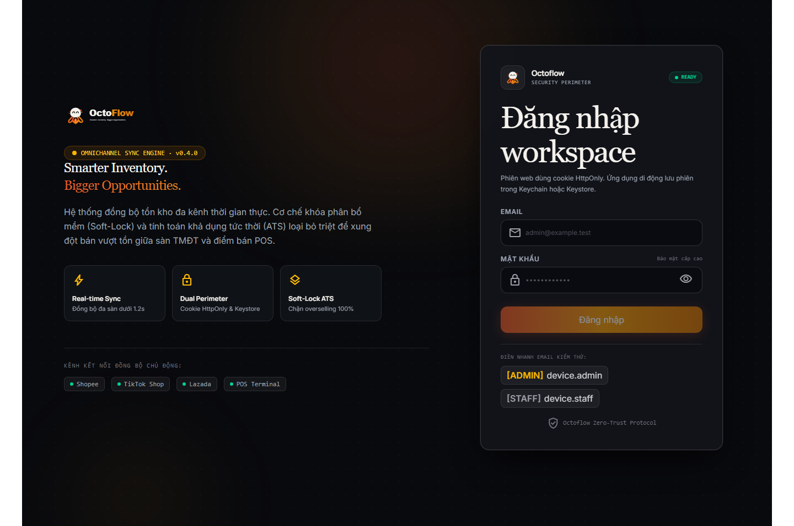
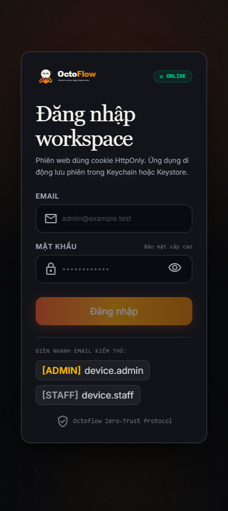
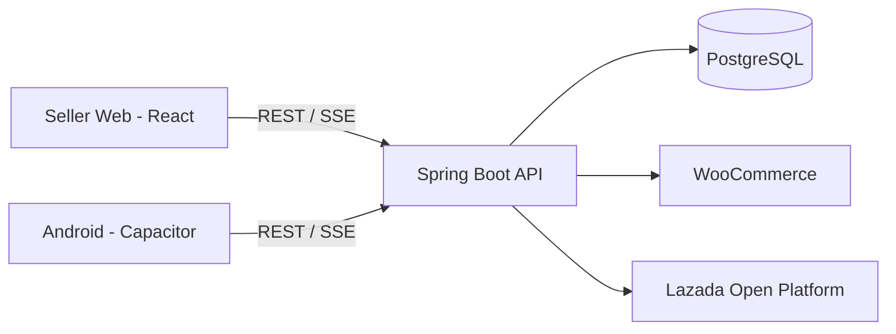

# OctoFlow

**Hệ thống quản lý tồn kho và đơn hàng đa kênh** cho cửa hàng bán lẻ. Dự án tập trung vào việc giữ một nguồn dữ liệu tồn kho nhất quán khi sản phẩm được bán qua POS và các kênh thương mại điện tử.

## Tổng quan

OctoFlow cung cấp giao diện quản trị cho danh mục sản phẩm, tồn kho, nhập hàng, đơn hàng và trạng thái đồng bộ. Backend được tổ chức thành một ứng dụng Spring Boot, dùng PostgreSQL làm nguồn dữ liệu chính; web app giao tiếp với API qua REST và nhận cập nhật đồng bộ qua SSE.

### Giao diện

<p>
  
</p>
<p>
  
</p>

### Phạm vi hiện có trong repository

| Phân hệ | Nội dung |
|---|---|
| Danh mục | Sản phẩm, biến thể và mapping listing theo kênh. |
| Tồn kho | Số dư, ledger, điều chỉnh, reservation, phiếu nhập và phân bổ tồn. |
| Đơn hàng / POS | Tạo đơn, xử lý vòng đời đơn và ghi nhận thanh toán. |
| Đồng bộ | Outbox, sync jobs, retry, reconciliation và cập nhật realtime qua SSE. |
| WooCommerce | Kiểm tra kết nối, quản lý mapping và nhập đơn từ cửa hàng đã xác minh. |
| Lazada | Luồng OAuth kết nối và quản lý token được mã hóa; cần thông tin ứng dụng để kết nối thật. |
| Bảo mật | Session cookie, CSRF, phân quyền `ADMIN`/`STAFF` và idempotency cho thao tác ghi. |

Các thao tác ghi ra hệ thống bên ngoài bị tắt theo mặc định và được điều khiển bằng cấu hình. Màn hình cho một kênh bán không đồng nghĩa backend đã có connector production cho kênh đó. Repository này không bao gồm dịch vụ AI/ML Python hay bản demo production được host.

## Kiến trúc



Một số quyết định kỹ thuật chính:

- Tính tồn có thể bán theo `on_hand - reserved - safety_buffer`.
- Dùng transaction và khóa dữ liệu ở database để bảo vệ các cập nhật tồn kho cạnh tranh.
- Dùng `Idempotency-Key` cho các thao tác ghi quan trọng để tránh xử lý lặp khi client retry.
- Ghi sự kiện đồng bộ vào outbox, sau đó xử lý qua worker; trạng thái được phát tới client bằng SSE.
- Mật khẩu, endpoint và khóa tích hợp được cấu hình qua biến môi trường; không đưa credential thật vào frontend.

Xem [TECH_STACK.md](TECH_STACK.md) để biết thêm về kiến trúc và các lựa chọn kỹ thuật.

## Công nghệ

- **Backend:** Java 21, Spring Boot 3.4, Spring Security, Spring Data JPA, Flyway.
- **Database:** PostgreSQL 17.
- **Web:** React 19, TypeScript, Vite, Tailwind CSS.
- **Mobile:** Capacitor; repository có Android project.
- **Kiểm thử:** JUnit, Testcontainers, Vitest, Testing Library và Playwright.

## Chạy local

Yêu cầu: JDK 21, Maven, Docker Compose và Node.js 24.

### 1. Khởi động PostgreSQL

Từ thư mục gốc:

```bash
docker compose -f compose.db.yaml up -d
```

Database local được mở tại `localhost:5433`.

### 2. Khởi động API

PowerShell:

```powershell
$env:SPRING_PROFILES_ACTIVE = "dev"
mvn -f apps/api/pom.xml spring-boot:run
```

Linux/macOS:

```bash
SPRING_PROFILES_ACTIVE=dev mvn -f apps/api/pom.xml spring-boot:run
```

API chạy tại `http://localhost:8085`; tài liệu Swagger tại `http://localhost:8085/swagger-ui.html`.

### 3. Khởi động web app

Mở terminal khác:

```bash
cd apps/seller
npm ci
npm run dev
```

Mở `http://127.0.0.1:5174`. Vite proxy các request `/api` và `/health` tới API local.

Profile `dev` chỉ dành cho máy local và tạo dữ liệu mẫu. Không dùng profile hoặc mật khẩu mặc định của môi trường dev khi triển khai production. Kết nối với WooCommerce/Lazada cần credential riêng; không commit các credential đó.

## Kiểm thử

Backend — một số integration test dùng Testcontainers và cần Docker đang chạy:

```bash
mvn -f apps/api/pom.xml test
```

Frontend:

```bash
cd apps/seller
npm test
npm run build
npm run check:secrets
```

## Android

Android app là web app được đóng gói bằng Capacitor. Xem [hướng dẫn build Android](apps/seller/android/README.md) và [chi tiết cài Android SDK](apps/seller/android/BUILD_GUIDE.md).
