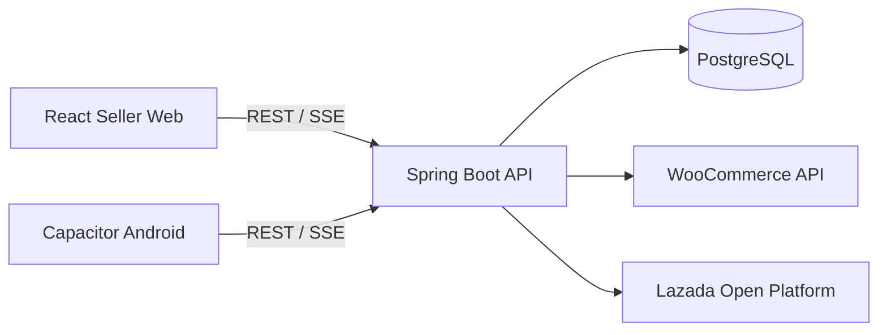

# OctoFlow — Kiến trúc kỹ thuật

Tài liệu này mô tả những gì đang có trong repository, không phải bản thiết kế cho các dịch vụ chưa được triển khai. Backend là một Spring Boot application; repository hiện không chứa runtime AI/ML Python.

## Sơ đồ hệ thống



Frontend dùng REST cho thao tác nghiệp vụ và SSE để nhận cập nhật đồng bộ. Backend lưu trạng thái chính trong PostgreSQL và gọi các connector bên ngoài khi được cấu hình.

## Công nghệ theo tầng

| Tầng | Công nghệ | Vai trò |
|---|---|---|
| API | Java 21, Spring Boot 3.4, Spring MVC | REST API, nghiệp vụ và xử lý nền. |
| Persistence | Spring Data JPA, Hibernate, PostgreSQL 17, Flyway | Lưu dữ liệu quan hệ và quản lý schema migration. |
| Bảo mật | Spring Security | Session cookie, CSRF và phân quyền theo vai trò. |
| Web | React 19, TypeScript, Vite, Tailwind CSS | Giao diện quản trị Seller. |
| Mobile | Capacitor 8, Android SDK 36 | Đóng gói giao diện web vào Android WebView. |
| Kiểm thử | JUnit, Testcontainers, Vitest, Testing Library, Playwright | Unit, integration, component và end-to-end tests. |
| API contract | springdoc-openapi, openapi-typescript | Cung cấp OpenAPI và sinh kiểu dữ liệu cho frontend. |

## Backend và cấu trúc mã nguồn

Backend hiện tổ chức theo trách nhiệm trong `apps/api/src/main/java/com/octoflow/api`:

- `controller/`, `dto/`: HTTP endpoints và request/response contracts.
- `service/`: nghiệp vụ sản phẩm, tồn kho, đơn hàng, nhập hàng, phân bổ và đồng bộ.
- `entity/`, `repository/`: mô hình dữ liệu và truy cập PostgreSQL.
- `adapter/`: client và adapter cho hệ thống/kênh bên ngoài.
- `scheduler/`: worker định kỳ cho reservation, sync jobs, outbox và reconciliation.
- `config/`, `middleware/`: cấu hình bảo mật, CORS, idempotency và request handling.

Frontend nằm trong `apps/seller/src`; Android wrapper nằm trong `apps/seller/android`.

## Tồn kho và tính nhất quán

Tồn khả dụng được tính từ các thành phần của số dư:

```text
available_to_sell = on_hand - reserved - safety_buffer
```

Các cập nhật ảnh hưởng tồn kho chạy trong transaction và dùng khóa database tại các điểm cần tránh oversell. Những thao tác ghi quan trọng nhận `Idempotency-Key` để một lần retry không tạo thêm thay đổi nghiệp vụ. Ledger lưu dấu vết thay đổi tồn trước/sau.

## Đồng bộ và tích hợp

Sự kiện nghiệp vụ được đưa qua outbox và xử lý bởi worker. Sync jobs hỗ trợ retry, lease và reconciliation; API phát các cập nhật cần thiết qua endpoint SSE `/api/v1/sync/stream`.

Các tích hợp backend có trong repository:

- **WooCommerce:** xác minh cấu hình/kết nối, mapping listing và nhập đơn từ store đã xác minh.
- **Lazada:** OAuth connection lifecycle, xác thực callback state và lưu token đã mã hóa.
- **Simulator:** adapter nội bộ để mô phỏng trạng thái kênh và kiểm thử luồng đồng bộ.

Tích hợp thật phụ thuộc credential và cấu hình môi trường. Cờ ghi ra WooCommerce/Lazada mặc định tắt; việc bật chúng cần được đánh giá riêng cho môi trường đích. Các màn hình hoặc cấu hình của kênh khác không được xem là bằng chứng backend connector đã hoàn chỉnh.

## Bảo mật

- API dùng session cookie và CSRF protection cho request thay đổi dữ liệu.
- Các route nghiệp vụ yêu cầu vai trò `ADMIN` hoặc `STAFF`; một số thao tác quản trị giới hạn ở `ADMIN`.
- Password được mã hóa bằng BCrypt.
- Secret của kênh và database được đọc từ biến môi trường. Giá trị `VITE_*` là public build-time config và không được chứa secret.
- Cấu hình profile `dev` chỉ để chạy local; không dùng profile này trên production.

## Kiểm thử và hợp đồng API

- Backend tests dùng Spring Boot Test; integration tests có Testcontainers/PostgreSQL và cần Docker.
- Frontend tests dùng Vitest và Testing Library; repo cũng có Playwright E2E tests.
- OpenAPI được dùng làm contract cho client TypeScript; các script kiểm tra contract nằm trong `apps/seller/scripts`.

Lệnh thường dùng và hướng dẫn chạy local nằm trong [README.md](README.md). Hướng dẫn Android ở [apps/seller/android/README.md](apps/seller/android/README.md).
