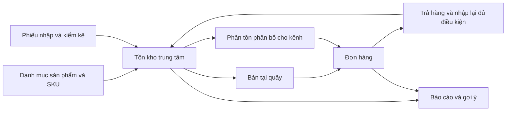

# 01 — Sản phẩm và phạm vi

## 1. Sản phẩm giải quyết việc gì?

**OctoFlow** (tên sản phẩm trong giao diện của dự án DATT — AI-driven Seller App) là không gian làm việc cho người bán quản lý một danh mục sản phẩm, một nguồn tồn kho và đơn hàng từ bán tại quầy hoặc các kênh bán được kết nối. Người bán cần biết hàng nào đang có, hàng nào đã giữ, còn bao nhiêu có thể bán; sau đó xử lý đơn và nhìn thấy tình trạng công bố/đồng bộ trên từng kênh.

Vấn đề chính là cùng một SKU có thể xuất hiện trên nhiều kênh. Nếu từng kênh giữ một con số tồn riêng mà không đối soát, người bán dễ đăng vượt số có thể giao. Sản phẩm đặt số tồn trung tâm làm căn cứ, phân bổ số được phép công bố cho từng kênh, ghi nhận mọi thay đổi và cho phép tìm nguyên nhân khi số trên kênh khác số mong đợi. AI chỉ đưa ra dự báo/cảnh báo để con người cân nhắc.

## 2. Ai dùng và nhận giá trị gì?

| Nhóm | Mục tiêu công việc | Giá trị nhận được |
|---|---|---|
| Chủ cửa hàng / Admin | Kiểm soát danh mục, tồn, kênh, công bố và ngoại lệ | Một nơi ra quyết định và xem lịch sử thao tác. |
| Nhân viên / Staff | Nhập hàng, bán tại quầy, xử lý đơn và trả hàng | Thao tác theo trạng thái rõ ràng, biết khi nào cần chuyển việc cho Admin. |
| Người mua cuối | Mua trên kênh bán hoặc tại quầy | Không sử dụng OctoFlow trực tiếp; trải nghiệm mua phụ thuộc kênh bán. |
| Kênh bán | Nhận thông tin sản phẩm/tồn và chuyển đơn về cửa hàng | Chỉ trao đổi trong phạm vi đã kết nối, có quyền và được xác minh. |

## 3. Ranh giới sản phẩm đã xác lập

- **Một cửa hàng, một kho logic.** Tồn được quản lý theo biến thể/SKU; không mặc định có nhiều chi nhánh hoặc nhiều doanh nghiệp độc lập.
- Khu vực người bán gồm: Tổng quan, Sản phẩm, Kho, Nhập hàng, Đơn hàng, Bán tại quầy, Kênh bán, Đồng bộ, Báo cáo, Trợ lý AI, Cài đặt. Một số khu vực hiện là minh họa; xem [ma trận trạng thái](04-danh-muc-chuc-nang.md).
- Các kênh trong sản phẩm hiện hướng tới **Shopify Development Store, WooCommerce Development Store và eBay Sandbox**. Mỗi kênh có phạm vi thao tác và bằng chứng sẵn sàng riêng. Tên kênh xuất hiện trong dữ liệu mẫu không có nghĩa đã kết nối thật.
- Bán tại quầy cần kết nối và số tồn/giá hiện hành. Giao dịch từ kênh ngoài phải qua bước nhận diện đúng sản phẩm và kiểm tra điều kiện trước khi ảnh hưởng tới tồn trung tâm.
- Thanh toán trong sản phẩm chủ yếu là **ghi nhận thủ công hoặc bằng chứng từ kênh**, không phải một cổng thu tiền của OctoFlow.

## 4. Sau khi hoàn thành phạm vi nghiệp vụ, người bán làm được gì?

Đây là **đích nghiệm thu nghiệp vụ**, không phải khẳng định mọi mục đã hoạt động trong môi trường hiện tại.

1. Đăng nhập theo vai trò và chỉ làm được những việc thuộc quyền của mình.
2. Tạo hoặc nhập danh mục; quản lý sản phẩm, biến thể, SKU, giá, mô tả và ảnh; biết sản phẩm nào là nháp, đang bán hoặc cần xử lý trên từng kênh.
3. Ghi nhận hàng nhận về, điều chỉnh sau kiểm kê có lý do, xem tồn hiện tại và lịch sử thay đổi; hệ thống không bán vượt lượng được phép bán.
4. Xem trước phần tồn phân bổ cho từng kênh; chỉ người có quyền mới thực hiện chuyển phân bổ; quan sát được số kênh đã xác nhận và chênh lệch còn tồn tại.
5. Bán tại quầy trên dữ liệu hiện hành; nhận đơn từ kênh đã kết nối; theo dõi đơn từ đặt đến giao, hủy đúng giai đoạn, xử lý trả hàng và xác định lượng hàng được nhập lại.
6. Phân biệt trạng thái thanh toán đã ghi nhận với tiền thực tế đã được đơn vị thanh toán/kênh xác nhận; không tự động coi giao hàng hoặc hoàn trả là đã thu/hoàn tiền.
7. Xem báo cáo từ dữ liệu nghiệp vụ thực, phân biệt giá trị đơn, tiền được ghi nhận, số hàng đã bán và số hàng có thể bán.
8. Xem dự báo/cảnh báo khi tính năng AI sẵn sàng, kèm nguồn và giới hạn; quyết định thay đổi tồn hoặc vận hành vẫn thuộc người bán.

Để tuyên bố **hoàn thành**, từng luồng trên cần có dữ liệu thật của phạm vi thử nghiệm đã chọn, kết quả ngoại lệ được thể hiện rõ và các trường hợp trong [bộ nghiệm thu](05-nghiem-thu-va-viec-con-lai.md) được kiểm chứng. Một luồng chỉ có dữ liệu mẫu hoặc chỉ có đường thao tác nhưng chưa đủ quyền kênh phải mang đúng nhãn trạng thái.

## 5. Ngoài phạm vi cơ sở

- Ứng dụng mua hàng riêng cho khách cuối.
- Nhiều cửa hàng độc lập, nhiều kho hoặc chuyển kho hoàn chỉnh.
- Bán tại quầy khi mất mạng rồi đồng bộ sau.
- Thu tiền qua cổng thanh toán của chính sản phẩm, đối soát ngân hàng và hoàn tiền tự động.
- Cam kết hoạt động trên tài khoản marketplace production hoặc cam kết không bao giờ bán vượt trên các kênh ngoài khi thông tin truyền đi có độ trễ.
- AI tự sửa tồn, giá, sản phẩm hay trạng thái đơn mà không qua quyết định nghiệp vụ của con người.
- Cam kết vận hành công khai với mức độ dịch vụ và quy trình khôi phục đã nghiệm thu.

## 6. Dấu hiệu thành công cần quan sát

| Kết quả | Cách nhận biết ở mức nghiệp vụ |
|---|---|
| Tồn đáng tin | Cùng một biến thể có số tồn, giữ hàng, đệm và số bán được nhất quán; mỗi thay đổi có lý do/lịch sử. |
| Đơn không lặp | Một thao tác bán/nhận đơn được gửi lại không tạo đơn hoặc trừ tồn lần hai. |
| Đa kênh có kiểm soát | Số dự định công bố không vượt tổng được phép bán; trạng thái gửi đi và số kênh báo về được tách riêng. |
| Vận hành rõ ngoại lệ | Thiếu ghép SKU, đơn đến sai thứ tự, mất xác nhận từ kênh hoặc sai lệch số lượng được đưa vào hàng cần xử lý. |
| Số liệu không gây hiểu nhầm | Màn hình phân biệt dữ liệu thật và dữ liệu mẫu; giá trị đơn không bị gọi là tiền đã thu; dự báo không bị gọi là doanh số thực. |

Không có mục tiêu định lượng như tỷ lệ giảm bán quá tồn hoặc doanh thu tăng được nhóm chốt trong nguồn hiện có. Nếu cần KPI để đánh giá đồ án hoặc triển khai thật, chủ dự án cần xác nhận ngưỡng và tập dữ liệu đo.

## 7. Kết quả đồ án ngoài chức năng người bán

Bên cạnh sản phẩm, kế hoạch đồ án còn yêu cầu **bằng chứng thực nghiệm có thể chạy lại**: so sánh cách đồng bộ tồn theo chu kỳ với cách phát thay đổi khi nghiệp vụ xảy ra; đánh giá độ trễ, lỗi/lặp sự kiện, bán vượt trên kênh, hiệu quả phân bổ/đệm và chất lượng các mô hình AI. Dữ liệu giả lập/công khai phải được ghi nguồn và tách khỏi kết quả trên cửa hàng thử. Hồ sơ nghiên cứu đã có một số giao thức/kết quả; kế hoạch EX01–EX08 không được mặc định là đã hoàn tất toàn bộ.

Đầu ra PM của đồ án còn gồm kịch bản trình diễn, kết quả kiểm chứng trên các nền tảng/kênh đã chốt, hướng dẫn cài lại và tài liệu/báo cáo nộp. Đây là đầu ra **học thuật và bàn giao**, không phải chức năng mà người bán bấm trong ứng dụng. Mốc thời gian dự kiến nằm ở [tài liệu nghiệm thu](05-nghiem-thu-va-viec-con-lai.md).
